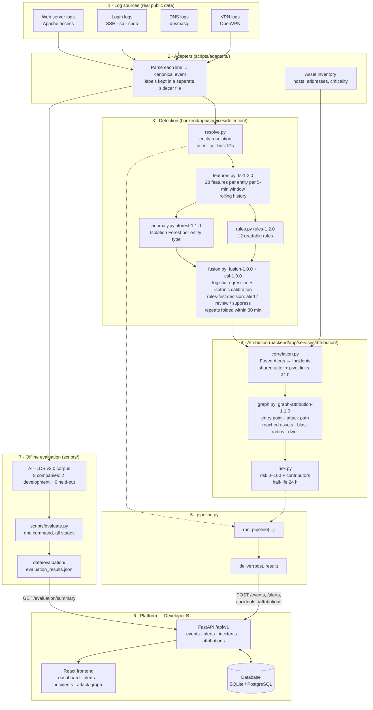

# System Overview — end to end, phase by phase

One place that explains **what the system is, how the pieces connect, and what happened in every phase**: the plan we decided, the problems we hit, the results, and the tests that prove each step.

- How to **run** and **test** everything: [`README.md`](../README.md)
- Full detail and every number: [`logs.md`](../logs.md) · plain-language summary for Developer B: [`guide_to_B.md`](../guide_to_B.md)
- Exact data formats: [`DETECTION_CONTRACT.md`](DETECTION_CONTRACT.md) · original plan: [`DETECTION_PLAN.md`](DETECTION_PLAN.md)

**Who owns what:** Developer A = detection, ML, correlation, attribution, risk, evaluation (`backend/app/services/`, `scripts/`, `data/`). Developer B = FastAPI, database, auth, frontend (`backend/app/api|models|schemas|core|db`, `frontend/`).

---

## 1. System diagram



### The same flow in one line per step

| # | Step | Input → output | Code | Contract § |
| :--- | :--- | :--- | :--- | :--- |
| 1 | **Adapters** | raw log line → canonical event (+ label in a sidecar file, never inside the event) | `scripts/adapters/*.py`, `scripts/convert_ait_scenario.py` | §1 |
| 2 | **Entity resolution** | event → enriched event with `actor_user / actor_ip / actor_host`, target, ID `ent-{type}-{sha256(tenant:id)[:8]}` | `detection/resolve.py` | §2 |
| 3 | **Features** | events → 28 numbers per entity per 5-minute window (counts, failure rates, new IP?, privileged ops, long DNS names…) | `detection/features.py` | §3 |
| 4 | **Rules** | feature vector → rule alerts (12 rules, thresholds from normal days, validation gate) | `detection/rules.py` | §4 |
| 5 | **Isolation Forest** | feature vector → anomaly score 0–1 (trained on normal windows only) | `detection/anomaly.py` | §4 |
| 6 | **Fusion** | rule hits + anomaly score + key features → calibrated confidence, decision `alert / review / suppress`, repeats folded | `detection/fusion.py` | §5 |
| 7 | **Correlation** | Fused Alerts → Incidents (alerts on the same actor, or one alert's target becomes the next alert's actor) | `attribution/correlation.py` | §6 |
| 8 | **Attribution** | incident → entry point, attack path (every step cites a real event), reached assets, blast radius, dwell time, graph | `attribution/graph.py` | §7 |
| 9 | **Risk** | incident → score 0–100, level, list of contributors | `attribution/risk.py` | §8 |
| 10 | **Delivery** | everything above → Developer B's API | `services/pipeline.py` | §10 |
| 11 | **Evaluation** | 8 AIT scenarios → `evaluation_results.json` → dashboard | `scripts/evaluate.py` | §9 |

### How we tested it honestly (the protocol)

```
AIT-LDS v2.0 — 8 simulated companies, same attack template, every attack line labelled
│
├── DEVELOPMENT (2): russellmitchell, fox
│     we looked at results here and changed the design
│
└── HELD-OUT (6): harrison, santos, shaw, wardbeck, wheeler, wilson
      converted + integrity-checked only
      ── design FROZEN and committed (18778e5) ──►  scored ONCE

Inside every company, time-ordered splits:
  day 1 = baseline │ next days = train │ day before attack = validation │ 1 h gap │ attack day → end = test
```

---

## 2. Phase-by-phase

Each phase lists: **Plan** (what we decided before building) · **Built** · **Problems & fixes** · **Result** · **Tests**.
Test counts are the whole backend suite at the end of that phase (Developer B's 59 tests included).

### Phase 0 — Setup and contract freeze · commits `0f57c4c`, `fbe9539`, `13f6c4a`

- **Plan:** agree every data shape between detection and the platform *before* writing detection code, so the two sides never block each other.
- **Built:** `docs/DETECTION_CONTRACT.md` (events, entities, feature vectors, alerts, fused alerts, incidents, attributions, risk, evaluation file) and `docs/DETECTION_PLAN.md` (phases 0–9). Change requests CR-01…CR-07 sent to Developer B (new alert / attribution fields, `POST /attributions`, entity-ID scheme) — **all delivered** by B and merged into `predictions`.
- **Problems found in the platform:** `bcrypt` 5.x breaks `passlib` (pin `bcrypt==4.0.1`); database path depended on the working directory (fixed by B); evaluation endpoint served hard-coded demo metrics when no results file existed; demo passwords hard-coded (fine for a demo only).
- **Result:** platform runs locally (backend :8000, frontend), login works, demo incident graph renders.
- **Tests:** **59 / 59** platform tests pass; Alembic migration + seed OK; frontend builds.

### Phase 1 — Real data and ground truth · commits `322be09`, `0c880fb`, `6739091`, `44eea44`, `62f29b2`

- **Plan:** originally a synthetic data generator. **Changed (with the user):** use **small slices of real public datasets** — synthetic data teaches the model the generator, not attacks. Database and cloud layers have no public labelled data → reported as **unvalidated**.
- **Built:**
  - **1a Org X** (Web Server Log Dataset, MIT): Apache adapter. 213,205 lines → 213,205 events, 0 contract problems.
  - **1c Org Y** (same dataset): SSH / sudo `auth.log` adapter + virtual-host web logs. 221,606 login/sudo events, 406 attacker IPs.
  - **1b labels + splits (Org Y):** `labeling.py` — window labels `incident / unknown / background`, time-ordered splits, a loader that **refuses** any incident leaking into train / validation.
  - **1d AIT-LDS v2.0 `russellmitchell`:** DNS and VPN adapters, AIT per-line labels. Fetched **23 files (~18 MB) out of a 7 GB zip** by HTTP range requests.
- **Problems & fixes:**
  - Org X has **one client IP** (a proxy) and no users → usable only as plumbing test data, not for evaluation.
  - Org Y has **one** incident and its compromise lines are not labelled → only an optimistic demo.
  - Real data exposed adapter bugs: sudo lines with `GROUP=` dropped; empty / space-containing SSH usernames silently skipped (61 events); label counts double-counted. All fixed and tested.
  - In AIT the DNS exfiltration runs **from the first minute** of the data → evaluated two ways ("as-is" and "clean baseline") and both reported.
- **Result:** AIT is the first dataset that allows honest evaluation (days of normal activity, then a labelled multi-step attack). Every labelled line recounted independently: web 7,695 = 7,695, DNS 17,978 = 17,978, VPN 1 = 1, auth 3 = 3.
- **Tests:** adapters (`test_web_server_adapter.py` 14, `test_syslog_auth_adapter.py` 15, `test_ait_adapters.py` 12), labels (`test_labeling.py` 29). Every source checked `lines = events + skipped + unparsed`. **Mutation checks** (break the code on purpose, a test must fail): 4/4, 4/4, 5/5, 4/4 caught. Suite: **197 passed**.

### Phase 2 — Entity resolution and feature engine · commit `bcf731f`

- **Plan:** one feature function used identically for training, evaluation and live use; deterministic (same input → same output); entity IDs byte-identical with the platform's.
- **Built:** `contract.py`, `resolve.py`, `features.py` (fs-1.0.0, 22 features), golden file `data/fixtures/expected_features.json`.
- **Problems & fixes:** a 1-second window-alignment bug was **not caught** by the first tests → added an exact-boundary test. Cold start: entities with < 20 baseline events get 0 for novelty instead of flagging every new user.
- **Result:** 20,000 events → 6,000 vectors in 1.1 s; replay and shuffled input give identical output.
- **Tests:** `test_resolve.py` 18, `test_features.py` 28 (hand-computed values). Mutation check 5/5 (after the fix). Suite: **105 passed**.

### Phase 3 — Detectors: rules + Isolation Forest · commits `83d3426`, `69004d3`

- **Plan:** rules = readable, precise; Isolation Forest = learns "normal", trained on normal windows only; thresholds come only from normal days; test split scored once; report precision, recall, **false alarms per day**, latency — never accuracy.
- **Built:** `envelope.py` (alert format), `rules.py` (rules-1.0.0, 9 rules), `anomaly.py` (iforest-1.0.0), `evaluation.py`, `scripts/evaluate_org_y.py`, `scripts/evaluate_ait.py`.
- **Problems & fixes:**
  - **Org Y:** caught 15/21 incident windows, first alert in 5 min — but **48 false alarms/day**, and RULE-PRIV-001 fired on every routine cron hour (threshold = background maximum with `>=`). Not fixed on that test set (that would be cheating) → **rules-1.1.0**: threshold = max × 1.25 with strict `>`, plus a **validation gate** (a rule firing on > 0.5 % of validation windows is switched off).
  - **First unseen test (AIT `russellmitchell`):** only the loud web scan caught — **1 of 4 attack stages**, 0 false alarms. Causes: cold start on the stolen account, a shared VPN address hiding the attacker, Isolation Forest scores saturating near 1.0, no DNS features.
- **Result:** honest baseline = precise but low recall. `russellmitchell` became a development scenario.
- **Tests:** `test_rules.py` 29, `test_anomaly.py` 8, `test_evaluation.py` 7, result-reproduction tests (`test_phase3_results.py`, `test_phase3_ait_results.py`: re-running the evaluation must reproduce the committed file exactly). Mutation checks 8/8 and 6/6. Suite: **235 passed**.

### Phase 1e + 3d — 8-scenario corpus and the frozen design · commit `18778e5`

- **Plan:** one incident cannot train anything → use all **8** AIT companies. Split **2 development / 6 held-out**. Every design change is decided on development data only; then freeze, commit, and score held-out once.
- **Built:** `fetch_remote_zip.py` (25–52 MB per company instead of 7–27 GB), `make_ait_spec.py` (one rule generates every company's splits), `adapters/ait_assets.py` (asset inventory), `build_ait_corpus.py`. Corpus: **3.7 million events, 8 intrusions**, all integrity checks pass.
- **Design changes (decided on `russellmitchell` + `fox`):**
  - **Rolling history** — each day is compared with everything seen before it (history was frozen at day 1).
  - **Login-history gate** — "new source IP" needs only 3 prior successful logins (the 20-event warm-up hid stolen credentials).
  - **fs-1.2.0** (+4 features → 28): service-account operations, credential-file access, distinct DNS names, long DNS names (≥ 100 chars).
  - **rules-1.2.0** (+3 → 12 rules): PRIV-004 service account runs `su`/`sudo`, PRIV-005 `/etc/shadow` read, NET-002 DNS tunnelling.
  - **Persistent-findings gate** — a rule over budget whose fires sit on ≤ 2 entities stays **on** (it was switching off the exfiltration rule because the theft was already running during validation).
- **Problems & fixes:** "company host" chosen by address range was wrong in 4 companies (dropped the attacked server) → chosen by **role name**, re-fetched. `wheeler` has 2 VPN sessions → generator generalised. Corpus build overwrote the hand-written spec → generated specs moved to `data/specs/ait/`. `servers.yaml` regex bug fixed. A DNS-burst rule (NET-001) caused false alarms and caught nothing → **removed**.
- **Result (development, in-sample):** `russellmitchell` 1/10 → 5/10 incident windows, all 4 stages, exfiltration 167/167; `fox` 5/14 → 9/14.
- **Tests:** `test_fetch_remote_zip.py`, `test_make_ait_spec.py`, `test_ait_assets.py` (role-name rule pinned by 20 tests), new rule / feature / gate tests. Mutation check 8/8.

### Phase 3e — Held-out evaluation of the frozen detectors · commit `c0e9627`

- **Plan:** score the 6 held-out companies once with the frozen design.
- **Result:**

| Decision | Intrusions caught | Incident windows | False alarms / day | Entry · Web · Privilege stages | Exfiltration | First alert |
| :--- | :--- | :--- | :--- | :--- | :--- | :--- |
| **rules-1.2.0, any rule** | **6 / 6** | 45 / 68 (66 %) | **0.38** | 6/6 · 6/6 · 6/6 | 111 / 112 | **5 min** |
| rules-1.2.0, high severity | 6 / 6 | 24 / 68 | **0.00** | 6/6 · 0/6 · 6/6 | 111 / 112 | 5 min |
| rules-1.1.0 (old) | 6 / 6 | 29 / 68 | 0.38 | 6/6 · 6/6 · **1/6** | **0 / 112** | 5 min |
| Isolation Forest ≥ 0.999 | 4 / 6 | 13 / 68 | 1.12 | 0/6 · 4/6 · 1/6 | 0 / 112 | 7.5 min |

  Held-out recall (66 %) ≥ development (58 %) → the changes **generalise**. Still missed: DNS discovery (no dedicated detection — open item).
- **Tests:** `test_phase3_ait_corpus.py` (numbers consistent, reproducible).

### Phase 4 — Fusion, calibration, alert fatigue · commit `8c4d035`

- **Plan:** combine rules + Isolation Forest into one calibrated confidence; logistic regression (gradient boosting as challenger); isotonic calibration; thresholds τ_alert (precision ≥ 0.8) and τ_review (keeps 90 % of attacks). **Pre-registered: rules first** — fusion may add alerts, never silence a rule.
- **Problems & fixes:** trained on one company, fusion gave **120 false alarms** on the other (it learned one exfiltration stream) → equal weight per (company, label) group + stronger regularisation (C = 0.1). Final test = **leave-one-scenario-out** (train on 7, test on the 8th).
- **Result (6 held-out folds):**
  - Fusion **ranks better than rules in 6/6 folds** (PR-AUC 0.681 vs 0.626); calibration ECE **0.002** (a stated 0.99 is right ~99 % of the time).
  - At the alert threshold it **does not beat rules**: 2.5 vs 0.38 false alarms/day for +2 attack windows → reported as is; pipeline stays rules-first, fusion gives the confidence and ranking.
  - Alert fatigue solved by **folding**: 22 flagged windows/day → **6.4 Fused Alerts/day**.
  - Review band empty on this data (confidence collapses to ≈ 0 or ≈ 1).
  - Gradient boosting worse (6 false alarms/day) → logistic regression kept.
- **Artefacts:** `data/evaluation/phase4_fusion_loso_{logreg,hgb}.json`, `data/evaluation/calibration.json`.
- **Tests:** `test_fusion.py` 13, `test_phase4_results.py` 7 (each fold trains on the other seven; pipeline never flags fewer attacks than rules alone). Mutation check 7/7.

### Phase 5 — Correlation into incidents · commit `1303bd8`

- **Plan:** group related alerts into one incident. Map addresses / vhosts to their host with the asset inventory so layers meet; link alerts that share an actor, or where one alert's target later acts (pivot); 24 h horizon.
- **Result:** the intrusion is **one incident in 6/6 held-out** companies (8/8 overall), holding 100 % of its alerts, across identity, network, application and endpoint layers; exfiltration correctly kept separate; ~2 incidents/day.
- **Problem (recorded, not tuned):** the **VPN server is a hub** — in `russellmitchell` 7 low-confidence benign VPN logins chained into the attack incident. Proposed fix (hub entities link only within ~1 h) needs new data to validate.
- **Tests:** `test_correlation.py` 7, `test_phase5_results.py` 2. Mutation check 5/5. Suite: **321 passed**.

### Phase 6 — Attribution: entry point, path, reach · commit `e2343f8`

- **Plan:** build a time-stamped entity graph (NetworkX) from the incident's events; entry = graph root; attack path = earliest-arrival route, every step citing a real event; reached assets, blast radius, dwell time, confidence, explanation sentence; output in the platform's `GraphNode` / `GraphEdge` shape.
- **Problem & fix (disclosed):** pre-registered **1.0.0** picked the earliest edge as the entry → wrong in `shaw` and `wilson` (a normal user's request on the shared VPN address came 1–2 min before the attacker). **1.1.0** implements the contract's "root of the graph" literally. Fixed **after** seeing held-out results → both reported.
- **Result (held-out):**

| | 1.0.0 (pre-registered) | 1.1.0 (current) |
| :--- | :--- | :--- |
| Entry account / address / exact event | 4 / 6 | **6 / 6** |
| Privileged host reached | 6 / 6 | 6 / 6 |
| Reached assets precision / recall | 1.00 / 0.56 | **1.00 / 0.69** |
| Dwell time exact | 4 / 6 | **6 / 6** |

- **Tests:** `test_attribution_graph.py` 11, `test_phase6_results.py` 4 (no identifiers in committed results). Mutation check 4/4. Suite: **336 passed**.

### Phase 7 — Explainable risk · commit `b9da00f`

- **Plan:** contract §8 formula `100 × (1 − Π(1 − confidence × weight × decay))`, weight = 0.5 + 0.1 × asset criticality, half-life 24 h; levels low / medium / high / critical at 25 / 50 / 75; every contribution listed.
- **Result:** intrusion **critical in 8/8**, **ranked first in 7/8** (held-out 5/6). `wilson`: a fresher benign alert 36 h later outranks it — time decay working as designed; UI should show score *and* first-seen time.
- **Tests:** `test_risk.py` 6, `test_phase7_results.py` 2.

### Phase 8 — One-command evaluation · commit `b2258dd`

- **Plan:** every number reproducible from one command.
- **Built:** `scripts/evaluate.py` runs all stages (16 detector runs, fusion ×2, correlation, attribution, risk) and writes `data/evaluation/evaluation_results.json` (contract §9; held-out numbers only; no accuracy; text notes in a separate `notes` object).
- **Result:** pipeline precision / recall / F1 **0.888 / 0.878 / 0.883**; alerts per analyst-day 21.1 → 6.4 → 2.0 incidents; entry point 1.00 (pre-registered 0.67); latency 300 s.
- **Reproducibility:** full rerun from scratch (~35 min) reproduced every committed file exactly (timestamps aside).
- **Tests:** `test_evaluation_results.py` 4.

### Phase 9 — Integration with the platform · commit `b2258dd`

- **Built:** `services/pipeline.py` — `run_pipeline(...)` (rules-only when no trained fusion model is passed) and `deliver(post, result, raw_events)` which posts events, `alert`/`review` alerts, incidents and attributions to B's API. `docs/HANDOFF_DEVELOPER_A.md`.
- **Result:** end-to-end test pushes a three-layer intrusion through the real pipeline **and Developer B's FastAPI app**: 43 events, 5 alerts, 1 incident, 1 attribution accepted (201) and read back with every field intact; `/evaluation/summary` serves our real figures.
- **Problems found → change requests to Developer B:**

| ID | Problem | Fix asked |
| :--- | :--- | :--- |
| CR-08 | `/evaluation/summary` silently returns hard-coded demo numbers if the results file fails validation | return / log the error |
| CR-09 | `POST /events` matches entities by `identifier` only → host and app with the same name collide | filter by `entity_type` too |
| CR-10 | attribution `method` accepted but not stored | store and return it |

  Also: one line of B's `test_api_v1.py` changed (it checked for a demo-only class name) — flagged for B's review. My mistaken claim that the attributions router was unmounted was caught by the test and corrected.
- **Tests:** `test_e2e_pipeline.py` 5. Suite: **353 passed, 3 skipped**.

---

## 3. Final scoreboard (6 held-out companies)

| Question | Answer |
| :--- | :--- |
| Attack detected? | **6 / 6**, first alert 5 min after the attacker's VPN login |
| False alarms | **0.38 / day** (high-severity rules: 0) |
| Analyst load | 21 flagged windows/day → 6.4 alerts/day → 2 incidents/day |
| Attack shown as one incident? | **6 / 6** |
| Entry point found? | **6 / 6** (pre-registered method 4 / 6) |
| Compromised server found? | **6 / 6**; reached-asset precision 1.0, recall 0.69 |
| Attack top risk? | critical 6 / 6, ranked first 5 / 6 |
| Calibration | ECE 0.002, Brier 0.002 |

## 4. Known limits and open items

- **One attack family** — 8 runs of the same intrusion template; results generalise to new companies, users and dates, not to new attack types.
- **Database and cloud layers unvalidated** (no public labelled data).
- **DNS discovery stage** not detected on its own → burst-rate DNS feature is the open item.
- **VPN hub in correlation** and **attribution 1.1.0** need new data to be confirmed.
- **Fusion** improves ranking and confidence, not the alert count at the threshold; review band empty on this data.
- Developer B: **CR-08, CR-09, CR-10**.
